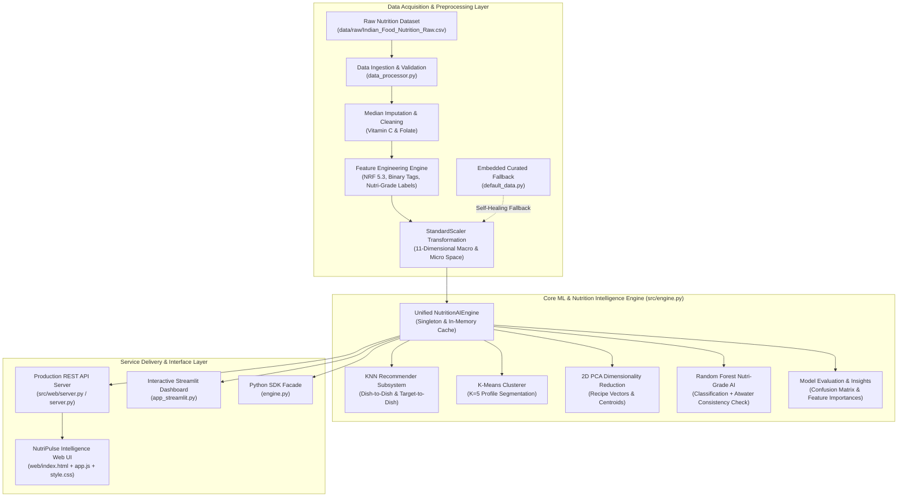
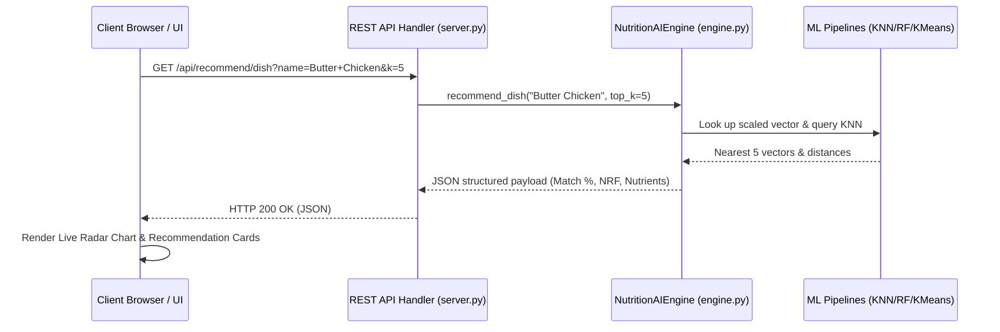

# 🏗️ System Architecture & Engineering Design

This document details the software architecture, data processing pipeline, mathematical foundations, and component interactions of the **AI-Powered Nutritional Recommender System**.

---

## 1. High-Level Architecture Diagram

---

## 2. Pipeline Subsystems

### 2.1 Preprocessing & Feature Engineering Layer (`src/preprocessing/data_processor.py`)
- **Median Imputation**: Replaces missing values in micronutrients (`Vitamin C (mg)` and `Folate (µg)`) using population medians to prevent scale distortion while preserving distribution properties.
- **Binary Categorical Flags**:
  - `High_Protein = 1` if $\text{Protein} > 10\text{g}$, else $0$.
  - `Low_Carb = 1` if $\text{Carbohydrates} < 15\text{g}$, else $0$.
  - `Low_Calorie = 1` if $\text{Calories} < 150\text{kcal}$, else $0$.
- **Ground Truth Nutri-Grade Categorization**:
  - **Grade C (Limit)**: $\text{Free Sugar} > 15\text{g} \lor \text{Fats} > 20\text{g} \lor \text{Sodium} > 600\text{mg}$
  - **Grade A (Healthy)**: $\text{Free Sugar} < 5\text{g} \land \text{Fats} < 5\text{g} \land \text{Sodium} < 200\text{mg}$
  - **Grade B (Moderate)**: All other nutrient profiles.

---

## 3. Mathematical & Algorithmic Foundations

### 3.1 Nutrient Rich Foods Index (NRF 5.3)
The NRF 5.3 index is a science-based nutrient density metric calculated by comparing the percentage Daily Values (%DV) of 5 encouraging nutrients against 3 limiting nutrients:

$$\text{NRF 5.3} = \sum_{i=1}^5 \left( \frac{\text{Nutrient}_i^+}{\text{DV}_i^+} \times 100 \right) - \sum_{j=1}^3 \left( \frac{\text{Nutrient}_j^-}{\text{DV}_j^-} \times 100 \right)$$

#### Daily Value (DV) Reference Standards:
| Encouraged Nutrients ($+$) | DV Standard | Limiting Nutrients ($-$) | DV Standard |
|---|---|---|---|
| **Protein** | $50\text{ g}$ | **Free Sugar** | $50\text{ g}$ |
| **Dietary Fibre** | $28\text{ g}$ | **Total Fats** | $78\text{ g}$ |
| **Vitamin C** | $90\text{ mg}$ | **Sodium** | $2300\text{ mg}$ |
| **Calcium** | $1300\text{ mg}$ | | |
| **Iron** | $18\text{ mg}$ | | |

A higher NRF 5.3 score indicates dense micronutrient and protein quality per serving relative to sugar, unhealthy fat, and sodium loads.

---

### 3.2 K-Nearest Neighbors (KNN) Vector Similarity
Each recipe is represented as an 11-dimensional feature vector:

$$\vec{x} = \begin{bmatrix} \text{Calories}, \text{Carbs}, \text{Protein}, \text{Fats}, \text{Sugar}, \text{Fibre}, \text{Sodium}, \text{Calcium}, \text{Iron}, \text{VitC}, \text{Folate} \end{bmatrix}^T$$

Vectors are standardized via Z-score normalization:

$$z_{ik} = \frac{x_{ik} - \mu_k}{\sigma_k}$$

The Euclidean distance between query vector $\vec{z}_q$ and candidate recipe $\vec{z}_d$ is:

$$d(\vec{z}_q, \vec{z}_d) = \sqrt{\sum_{k=1}^{11} (z_{qk} - z_{dk})^2}$$

The distance is transformed into an intuitive, bounded percentage match score:

$$\text{Match Percentage} = \frac{100}{1 + d(\vec{z}_q, \vec{z}_d)}$$

---

### 3.3 K-Means Clustering & 2D PCA Spatial Mapping
- **Clustering**: $K$-Means partitions the standardized 11D nutrient space into $K=5$ clusters using $k$-means++ centroid initialization.
- **Dynamic Semantic Labeling**:
  - $\text{Cluster Mean}(\text{Free Sugar}) > 15\text{g} \implies \text{🍭 Sweet/Dessert}$
  - $\text{Cluster Mean}(\text{Fats}) > 20\text{g} \implies \text{🧀 Rich/High Fat}$
  - $\text{Cluster Mean}(\text{Protein}) > 15\text{g} \implies \text{💪 High Protein}$
  - $\text{Cluster Mean}(\text{Calories}) < 150\text{kcal} \implies \text{🥗 Light/Snack}$
  - $\text{Default} \implies \text{🍛 Balanced Meal}$
- **PCA Dimensionality Reduction**: Projects the 11D vectors and the 5 cluster centroids $\boldsymbol{\mu}_k$ onto a 2D plane $(x, y)$ for interactive visual exploration:
  $$\mathbf{X}_{2D} = \mathbf{Z} \mathbf{W}_2, \quad \boldsymbol{\mu}_{2D, k} = \boldsymbol{\mu}_k \mathbf{W}_2$$

---

### 3.4 Nutri-Grade AI Classification & Atwater Caloric Consistency
- **Random Forest Classifier**: Trained on 7 core macronutrients (`Calories`, `Carbohydrates`, `Protein`, `Fats`, `Free Sugar`, `Fibre`, `Sodium`) using 100 decision trees with Gini impurity splitting.
- **Atwater Energy Consistency Check**:
  When users provide partial inputs (e.g. only Sugar, Fat, and Sodium), estimating caloric density prevents out-of-distribution hallucinations:
  $$\text{Estimated Calories} = (\text{Fat} \times 9) + (\overline{\text{Protein}} \times 4) + (\overline{\text{Carbohydrates}} \times 4)$$
  where $\overline{\text{Protein}}$ and $\overline{\text{Carbohydrates}}$ denote the population empirical means.

---

## 4. Web Application & Client-Server Architecture

